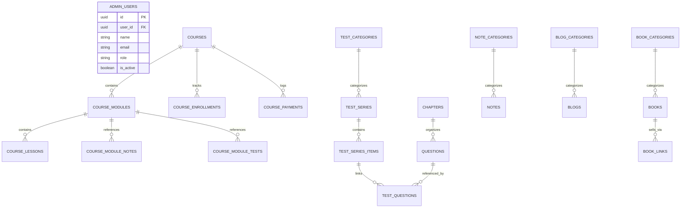

# 🚀 CCC Prep — Modern Admin Dashboard & LMS Portal

<div align="center">


**The unified content management system, exam engine, course builder, and AI-augmented editorial suite powering the CCC Prep educational ecosystem.**

[](https://react.dev/)
[](https://vitejs.dev/)
[](https://www.typescriptlang.org/)
[](https://tailwindcss.com/)
[](https://supabase.com/)
[](https://ai.google.dev/)
[](LICENSE)
[](https://github.com/dev-gauravjha/ccc-prep-admin/pulls)

[Live Demo](#) • [Features](#-key-features) • [Quick Start](#-quick-start) • [Database Schema](#-database-architecture) • [AI Features](#-google-gemini-ai-studio) • [Contributing](#-contributing)

</div>

---

## 📖 Table of Contents

- [Overview](#-overview)
- [Key Features](#-key-features)
  - [📊 Mission-Control Dashboard](#-mission-control-dashboard)
  - [🎓 Course Management System (LMS)](#-course-management-system-lms)
  - [📝 Test Series & Exam Engine](#-test-series--exam-engine)
  - [❓ Bilingual Question Bank & AI Studio](#-bilingual-question-bank--ai-studio)
  - [📚 Syllabus & Chapter Management](#-syllabus--chapter-management)
  - [📑 PDF Notes & Document Hub](#-pdf-notes--document-hub)
  - [✍️ Blog CMS & Creative Studio](#️-blog-cms--creative-studio)
  - [📖 Books & Affiliate Store](#-books--affiliate-store)
  - [👥 Student Enrollments & Tracking](#-student-enrollments--tracking)
  - [🛡️ Role-Based Access Control (RBAC)](#️-role-based-access-control-rbac)
  - [📴 Offline / Mock Fallback Mode](#-offline--mock-fallback-mode)
- [Tech Stack](#-tech-stack)
- [Project Directory Structure](#-project-directory-structure)
- [Quick Start Guide](#-quick-start)
  - [Prerequisites](#prerequisites)
  - [Installation](#1-clone-and-install)
  - [Environment Variables](#2-configure-environment-variables)
  - [Supabase Setup](#3-configure-supabase-database)
  - [Development Server](#4-run-the-development-server)
  - [Production Build](#5-production-build--preview)
- [Database Architecture & Storage](#-database-architecture)
- [Google Gemini AI Studio](#-google-gemini-ai-studio)
- [UI / UX Design System](#-ui--ux-design-system)
- [Available Scripts](#-available-scripts)
- [Security & Best Practices](#-security--best-practices)
- [Contributing](#-contributing)
- [License](#-license)

---

## 🌟 Overview

The **CCC Prep Admin Panel** is an enterprise-grade, responsive administration dashboard built to manage all learning content, mock exams, question banks, digital study notes, affiliate resources, and courses for the **NIELIT CCC (Course on Computer Concepts)** exam preparation mobile and web apps.

Engineered with **React 18**, **TypeScript**, **Tailwind CSS**, and backed by **Supabase (PostgreSQL, Auth & Storage)**, this admin portal incorporates next-gen **Google Gemini AI** integrations to automate question creation, SEO metadata crafting, article drafting, and dynamic thumbnail banner generation.

### Why CCC Prep Admin?

- **Bilingual-First Design**: Full dual-language support (English & Hindi) for questions, options, explanations, notes, blogs, and course syllabi.
- **AI-Powered Acceleration**: Dramatically cuts content authoring time using Google Gemini Flash models for automated question generation and SEO-optimized articles.
- **Enterprise LMS Capabilities**: Multi-tier course architecture (Courses ➔ Modules ➔ Lessons) with video streaming support, progress tracking, and payment logging.
- **Resilient Offline / Demo Mode**: Instant fallback to an in-memory mock data system when Supabase credentials are not connected or during isolated UI testing.
- **Premium Dark Aesthetics**: Styled with a bespoke deep obsidian background, glassmorphism card surfaces, and radiant **Cosmic Lavender** accents.

---

## ✨ Key Features

### 📊 Mission-Control Dashboard
- **Real-Time KPI Cards**: Monitor live metrics for total questions, test series, active test sets, PDF downloads, blogs, books, courses, and registered students.
- **Content Distribution Overview**: Visual tracking of published vs. draft content items across all categories.
- **Featured Content Highlights**: Instant visibility into pinned test series, top-selling courses, and recently modified assets.
- **Quick Action Bar**: One-click navigation to create tests, generate AI questions, draft blog articles, or upload notes.

### 🎓 Course Management System (LMS)
- **Hierarchical Course Builder**: Structure comprehensive learning tracks:
  $$\text{Course} \longrightarrow \text{Modules} \longrightarrow \text{Lessons}$$
- **Multi-Format Lessons**: Support for video lectures (YouTube/Vimeo/Direct MP4 embeds), rich text/markdown reading modules, and mixed lessons with downloadable resources.
- **Smart Resource Attachment**: Attach existing Question Bank quizzes, Full Mock Tests, and PDF Notes directly into course modules without content duplication.
- **Monetization & Pricing**: Flexible free preview lessons, paid tiers with multi-currency support (INR ₹, USD $), and architectural readiness for Razorpay payment webhooks.
- **Analytics & Progress**: Real-time student progress tracking (% completed, completed lessons count) and payment transaction logs (Order ID, Payment ID, Gateway status).

### 📝 Test Series & Exam Engine
- **Category Hierarchy**: Organize tests by exam patterns (NIELIT CCC, Topic-Wise Practice, Speed Tests, Full Mock Tests, Previous Year Papers).
- **Test Set Configuration**: Granular control over exam duration (minutes), total marks, passing score, question count, difficulty levels, and optional negative marking rules.
- **Question Ordering Matrix**: Assign questions from the central question bank with deterministic sequence control (`question_order`).
- **AI Test Series SEO Generator**: One-click generation of SEO-friendly URL slugs, meta descriptions, high-yield summary cards, and keyword tags powered by Gemini AI.

### ❓ Bilingual Question Bank & AI Studio
- **Dual-Language Schema**: Every question supports both English and Hindi text for questions, options (A, B, C, D), and comprehensive rationale explanations.
- **Question Types**: Multiple Choice Questions (MCQs) and True / False questions with difficulty classifications (`Easy`, `Medium`, `Hard`).
- **Bulk Excel / CSV Import**: Upload hundreds of questions at once via `.xlsx` or `.csv` files with automated column validation, error highlighting, and batch ingestion.
- **Google Gemini AI Question Studio**:
  - Automatically generates batch exam questions aligned to specific NIELIT CCC chapters or custom topics.
  - Generates realistic bilingual distractors, correct answers, and Hindi/English pedagogical rationales.
  - Automatically checks against duplicate questions and imports verified questions directly to the database.

### 📚 Syllabus & Chapter Management
- **Structured Syllabus Tree**: Manage all official CCC curriculum chapters (e.g., *Introduction to Computer, GUI Operating Systems, LibreOffice Writer, Calc, Impress, Internet & WWW, Digital Financial Services, Cyber Security*).
- **Bilingual Taxonomy**: Dual-language naming (`title` & `hindi_title`) and manual sequence sorting (`sort_order`).

### 📑 PDF Notes & Document Hub
- **Categorized Study Materials**: Organize revision guides, formula sheets, shortcut key sheets, and chapter notes.
- **Supabase Storage Integration**: Direct cloud upload for PDFs and custom cover thumbnails with public URL resolution and file deduplication.
- **Document Metadata**: Automatic extraction and storage of file size (KB/MB), page counts, and publication timestamps.

### ✍️ Blog CMS & Creative Studio
- **Dual-Language Publishing**: Create synchronized English and Hindi articles with custom URL slugs and social sharing summaries.
- **Rich Markdown Editor**: Integrated `@mdxeditor/editor` with live WYSIWYG formatting, headers, code blocks, lists, and quotes.
- **AI Article Assistant**: Generate comprehensive study articles, quick revision guides, or exam cheatsheets on any topic in seconds.
- **Dynamic Canvas / SVG Banner Studio**: Generates high-resolution social share and blog thumbnail banners using customized color palettes (Cosmic Lavender, Cyber Emerald, Ocean Cobalt, Sunset Amber) without requiring external graphics software.

### 📖 Books & Affiliate Store
- **Recommended Reading Showcase**: Maintain a directory of recommended NIELIT CCC textbooks and question banks.
- **Multi-Retailer Affiliate Engine**: Attach multiple affiliate purchase links per book (Amazon, Flipkart, BookBazaar, custom platforms) with live price and currency tracking.

### 👥 Student Enrollments & Tracking
- **Unified Enrollment Ledger**: Monitor student registrations across both Mock Test Series and comprehensive Video Courses.
- **Access Lifecycle**: Manage access tiers (`Free`, `Paid`, `Promotional Pass`) and lifecycle statuses (`Active`, `Expired`, `Revoked`).

### 🛡️ Role-Based Access Control (RBAC)
- **Supabase Authentication**: Secure email/password login, password recovery, session renewal, and protected client routes.
- **Permission Matrix**:
  - `super_admin`: Full system authority, administrative user provisioning, role assignments, database maintenance.
  - `editor`: Access to content authoring (Courses, Tests, Questions, Notes, Blogs, Books).

### 📴 Offline / Mock Fallback Mode
- Zero-friction developer onboarding: When running locally without active Supabase credentials, the app seamlessly boots into an in-memory mock data environment (`MockDataContext`) loaded with representative mock questions, test sets, courses, and chapters.

---

## 💻 Tech Stack

| Domain | Technology / Library | Description |
|---|---|---|
| **Core Framework** | [React 18.3](https://react.dev/) | Modern reactive component architecture with Hooks & Context API |
| **Build Tool** | [Vite 6.1](https://vitejs.dev/) | Ultra-fast Next-Gen frontend tooling & Hot Module Replacement (HMR) |
| **Language** | [TypeScript 5.7](https://www.typescriptlang.org/) | Strict type checking, interfaces, and end-to-end data contracts |
| **Styling & Design** | [Tailwind CSS 3.4](https://tailwindcss.com/) | Utility-first CSS framework customized with dark lavender theme |
| **Icons** | [Lucide React](https://lucide.dev/) | Clean, consistent vector iconography |
| **Backend & Database** | [Supabase](https://supabase.com/) | Hosted PostgreSQL, Row-Level Security (RLS), and Realtime API |
| **Auth & Security** | [Supabase Auth](https://supabase.com/docs/guides/auth) | JWT-based authentication, password recovery, session handling |
| **File Storage** | [Supabase Storage](https://supabase.com/docs/guides/storage) | Cloud object storage for PDFs, covers, thumbnails, and banners |
| **AI / LLM Engine** | [@google/genai 2.19](https://www.npmjs.com/package/@google/genai) | Official Google Gen AI SDK (Gemini 2.5 Flash / 3.7 Flash) |
| **Markdown WYSIWYG** | [@mdxeditor/editor 4.2](https://mdxeditor.dev/) | Rich, interactive Markdown and block content authoring |
| **Spreadsheet Processing** | [XLSX (SheetJS)](https://sheetjs.com/) | Client-side Excel & CSV parsing for bulk question ingestion |
| **Routing** | [React Router DOM 6.29](https://reactrouter.com/) | Declarative client-side routing with guarded route wrappers |

---

## 📂 Project Directory Structure

```text
ccc-prep-admin/
├── public/                       # Static public assets & favicon
├── src/
│   ├── components/               # Reusable UI & Layout components
│   │   ├── common/               # Atomic components (Buttons, Badges, Modals, Tables, Inputs)
│   │   │   ├── DataTable.tsx     # High-density data table with sorting, search, pagination
│   │   │   ├── FileUpload.tsx    # Supabase storage drag-and-drop uploader
│   │   │   ├── MDXEditorComponent.tsx # Rich text markdown editor wrapper
│   │   │   ├── Modal.tsx         # Accessible overlay modals with focus trapping
│   │   │   └── SearchFilterBar.tsx# Standard search and dropdown filtering bar
│   │   └── layout/               # Shell layout, Sidebar navigation, Header, User Menu
│   │       ├── AdminLayout.tsx
│   │       ├── Header.tsx
│   │       └── Sidebar.tsx
│   ├── constants/                # Global configuration & route path constants
│   │   ├── config.ts             # Storage bucket names, page size options, role definitions
│   │   └── routes.ts             # Type-safe application route URLs
│   ├── contexts/                 # React Context providers for global state
│   │   ├── AuthContext.tsx       # Supabase authentication session & admin user state
│   │   ├── MockDataContext.tsx   # Offline fallback seed database
│   │   ├── ThemeContext.tsx      # Dark / light theme management
│   │   └── ToastContext.tsx      # Interactive toast alerts & notifications
│   ├── lib/                      # External client initializations & helpers
│   │   ├── sqlSchema.ts          # Complete PostgreSQL schema & migration SQL scripts
│   │   ├── storage.ts            # Supabase cloud storage upload handlers
│   │   ├── supabase.ts           # Supabase client instantiation & connectivity check
│   │   └── utils.ts              # Slug generation, formatters, string utilities
│   ├── pages/                    # Route-level page views
│   │   ├── auth/                 # Login & Forgot Password views
│   │   ├── blogs/                # Blog lists, AI Generator Modal, Rich Editor
│   │   ├── books/                # Book catalog & multi-retailer affiliate links
│   │   ├── chapters/             # Syllabus chapters management
│   │   ├── courses/              # Course list, Module Builder, Enrollments, Payments
│   │   ├── dashboard/            # Mission-control dashboard & analytics
│   │   ├── enrollments/          # Test series enrollment ledger
│   │   ├── notes/                # PDF study notes upload & category manager
│   │   ├── questions/            # Question bank, AI Studio, Bulk XLSX uploader
│   │   ├── settings/             # Admin users, Profile, Database SQL setup utility
│   │   └── tests/                # Test categories, series, test set editor, SEO modal
│   ├── routes/                   # Route table definitions and authentication guards
│   │   ├── AppRoutes.tsx
│   │   └── ProtectedRoute.tsx
│   ├── services/                 # API service layer interfacing with Supabase & Gemini
│   │   ├── adminService.ts
│   │   ├── blogService.ts
│   │   ├── bookService.ts
│   │   ├── chapterService.ts
│   │   ├── courseService.ts
│   │   ├── enrollmentService.ts
│   │   ├── geminiBlogService.ts
│   │   ├── geminiService.ts
│   │   ├── geminiTestSeriesService.ts
│   │   ├── noteService.ts
│   │   ├── questionService.ts
│   │   └── testService.ts
│   ├── types/                    # TypeScript interfaces & database entity schemas
│   │   └── database.ts
│   ├── App.tsx                   # Main component wrapping Context providers
│   ├── index.css                 # Custom Tailwind CSS layers & animations
│   └── main.tsx                  # Application entry point
├── .env.example                  # Environment configuration template
├── package.json                  # Dependencies, scripts, and package metadata
├── tailwind.config.js            # Tailwind custom colors, typography, and plugins
├── tsconfig.json                 # TypeScript compiler configuration
└── vite.config.ts                # Vite build & plugin pipeline configuration
```

---

## ⚡ Quick Start

### Prerequisites
- **Node.js**: v18.0.0 or higher ([Download Node.js](https://nodejs.org/))
- **npm** (v9+) or **pnpm** / **yarn**
- *(Optional)* A [Supabase](https://supabase.com/) account for live database and storage.
- *(Optional)* A [Google AI Studio](https://aistudio.google.com/) API Key for AI features.

---

### 1. Clone and Install

```bash
# Clone the repository
git clone https://github.com/dev-gauravjha/ccc-prep-admin.git

# Navigate into the project directory
cd ccc-prep-admin

# Install project dependencies
npm install
```

---

### 2. Configure Environment Variables

Create your local `.env` configuration by copying `.env.example`:

```bash
cp .env.example .env
```

Open `.env` in your editor and configure your credentials:

```ini
# Supabase Configuration
VITE_SUPABASE_URL=https://your-project-id.supabase.co
VITE_SUPABASE_ANON_KEY=your-supabase-anon-key

# Google Gemini AI Key (Optional - can also be configured inside the app UI)
VITE_GEMINI_API_KEY=your-gemini-api-key
```

> [!NOTE]
> If you leave `VITE_SUPABASE_URL` and `VITE_SUPABASE_ANON_KEY` blank or pointing to placeholders, the panel will gracefully activate **Demo / Mock Mode**, allowing you to preview and interact with the UI without any database setup!

---

### 3. Configure Supabase Database

If connecting to a live Supabase project:

1. Open your [Supabase Dashboard](https://supabase.com/dashboard) and create a new project.
2. Navigate to the **SQL Editor**.
3. Copy the complete SQL initialization script from `src/lib/sqlSchema.ts` (or access the built-in **Database Setup** tab in the admin panel at `/settings/database`).
4. Execute the SQL script. This will automatically create:
   - All relational tables (`admin_users`, `courses`, `test_series`, `questions`, etc.).
   - Database indexes for high-speed queries.
   - Row Level Security (RLS) policies.
   - Required Supabase Storage buckets.
5. Create your initial admin user in Supabase Authentication and insert a record into `public.admin_users` with `role = 'super_admin'`:
   ```sql
   INSERT INTO public.admin_users (user_id, name, email, role, is_active)
   VALUES ('YOUR_AUTH_USER_UUID', 'Admin Name', 'admin@example.com', 'super_admin', true);
   ```

---

### 4. Run the Development Server

```bash
npm run dev
```

Visit **`http://localhost:5173`** in your browser to access the admin dashboard.

---

### 5. Production Build & Preview

Verify types and build optimized production bundles:

```bash
# Build the production bundle into dist/
npm run build

# Preview the production build locally
npm run preview
```

---

## 🗄️ Database Architecture

The system uses a normalized PostgreSQL relational schema designed for optimal join efficiency and referential integrity:



### Primary Database Tables

| Table Name | Description | Key Relationships |
|---|---|---|
| `admin_users` | Admin accounts and permission roles (`super_admin`, `editor`) | Links to Supabase `auth.users` |
| `courses` | Top-level courses, pricing, currency, and publishing flags | Root entity for LMS |
| `course_modules` | Syllabus sections within a course | Belongs to `courses` |
| `course_lessons` | Individual video / text lectures and preview states | Belongs to `course_modules` |
| `course_enrollments`| Student course registrations and completion metrics | Joins `courses` & students |
| `course_payments` | Transaction records, payment gateway IDs, order status | Joins `courses` & students |
| `test_categories` | High-level exam categories (Mock, Speed, Topic) | Root for test hierarchy |
| `test_series` | Collections of test sets with pricing and badges | Belongs to `test_categories` |
| `test_series_items` | Individual timed test papers with negative marking | Belongs to `test_series` |
| `test_questions` | Many-to-many junction assigning questions to test sets | Joins `test_series_items` & `questions` |
| `questions` | Central bilingual question bank (English & Hindi) | Categorized by `chapters` |
| `chapters` | NIELIT CCC curriculum syllabus chapters | Referenced by `questions` |
| `notes` | Downloadable PDF study guides and revision sheets | Categorized by `note_categories` |
| `blogs` | Bilingual editorial articles and study tips | Categorized by `blog_categories` |
| `books` | Exam preparation textbooks and study guides | Categorized by `book_categories` |
| `book_links` | Multi-retailer affiliate purchase links (Amazon, Flipkart) | Belongs to `books` |
| `series_enrollments`| Test series student registrations and access lifecycle | Joins `test_series` & students |

### Supabase Storage Buckets

The panel utilizes dedicated object storage buckets:
- `course-thumbnails` — Course cover graphics.
- `test-series-images` — Test series promotional banners.
- `notes-pdf` — Downloadable PDF documents.
- `notes-thumbnails` — PDF preview images.
- `blog-images` — Blog article hero banners.
- `book-covers` — Textbook covers.
- `avatars` — Admin user profile photos.

---

## 🤖 Google Gemini AI Studio

The admin panel integrates **Google Gemini 2.5 Flash** and **Gemini 3.7 Flash** via the official `@google/genai` SDK to accelerate instructional design and publishing:

### 1. Bilingual Question Generator (`AiQuestionGenerateModal.tsx`)
- **Multi-Model Support**: Select between `Auto (Recommended)`, `Gemini 2.5 Flash`, `Gemini 3.7 Flash`, or `Gemini 3.5 Flash Lite`.
- **Parametric Generation**: Configure Chapter topic, difficulty (`Easy`, `Medium`, `Hard`, or `Mixed`), number of MCQs, and True/False questions.
- **Smart Duplicate Prevention**: Passes existing question excerpts in the prompt context to prevent identical questions.
- **Direct Database Ingestion**: Review, edit, or reject AI-generated questions before committing them to Supabase.

### 2. Test Series SEO & Marketing Generator (`AiTestSeriesSeoModal.tsx`)
- Generates high-ranking URL slugs, compelling search engine meta descriptions, highlight bullet points, and high-yield keyword tags tailored for Indian exam aspirants.

### 3. AI Blog Writer & Dynamic Banner Studio (`AiBlogGenerateModal.tsx`)
- Generates long-form bilingual revision guides with structured headings, key takeaways, and sample exam questions.
- Built-in HTML5 Canvas banner renderer creates gradient promotional images ready for social media and website previews.

---

## 🎨 UI / UX Design System

The application features a tailored **Cosmic Lavender Dark Theme** crafted with precision:

- **Color Palette**:
  - `Background`: Deep Obsidian (`#0b0d13`)
  - `Card / Surface`: Slate Gray (`#131722`) with subtle border highlights (`#232838`)
  - `Primary Accent`: Radiant Lavender (`#8b5cf6` / `#a78bfa`)
  - `Success`: Emerald (`#10b981`)
  - `Warning`: Amber (`#f59e0b`)
  - `Danger`: Rose (`#f43f5e`)
- **Typography**: Inter for high-legibility UI data; Outfit for expressive headings.
- **Interactive Feedback**: Accessible modals, confirmation dialogs for destructive actions, floating toast notifications, and skeleton loaders.

---

## 📜 Available Scripts

In the project directory, you can run:

```bash
# Start local development server with HMR on http://localhost:5173
npm run dev

# Run TypeScript type-check and generate production build in /dist
npm run build

# Preview the local production build
npm run preview
```

---

## 🔒 Security & Best Practices

- **Zero Service-Role Exposure**: The frontend strictly utilizes the Supabase `anon` public key. Privileged operations are guarded by PostgreSQL **Row-Level Security (RLS)** and authenticated sessions.
- **Isolated Registration Client**: Admin user creation utilizes an isolated authentication instance so the active administrator's session is never disrupted.
- **Client-Side Key Management**: Gemini API keys can be supplied via environment variables or securely stored in the administrator's local browser storage.
- **Safe HTML / Markdown Rendering**: Strict sanitize-safe rendering for markdown previews and AI-generated outputs.

---

## 🤝 Contributing

Contributions to improve CCC Prep Admin are welcome!

1. **Fork** the repository.
2. Create your feature branch:
   ```bash
   git checkout -b feature/amazing-feature
   ```
3. Commit your changes:
   ```bash
   git commit -m "feat: Add amazing feature"
   ```
4. Push to your branch:
   ```bash
   git push origin feature/amazing-feature
   ```
5. Open a **Pull Request**.

---

## 📄 License

This project is licensed under the **MIT License** — see the [LICENSE](LICENSE) file for details.

---

<div align="center">

Crafted with ❤️ for **CCC (Course on Computer Concepts)** aspirants & educators.

</div>
